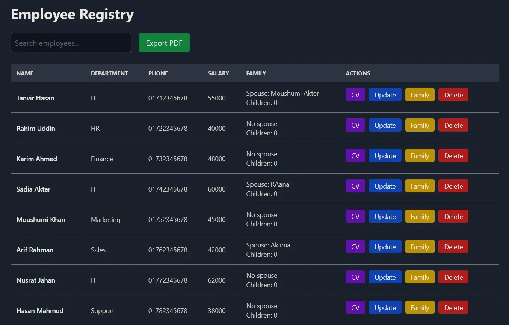
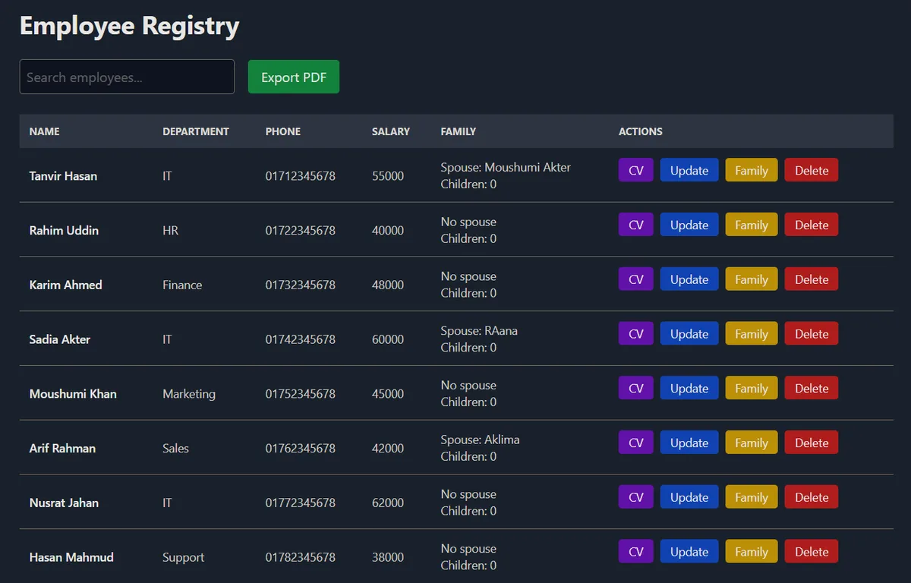
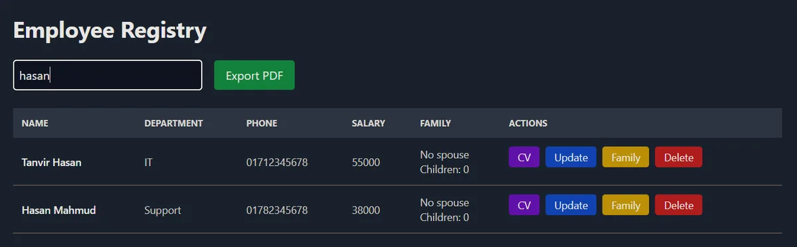
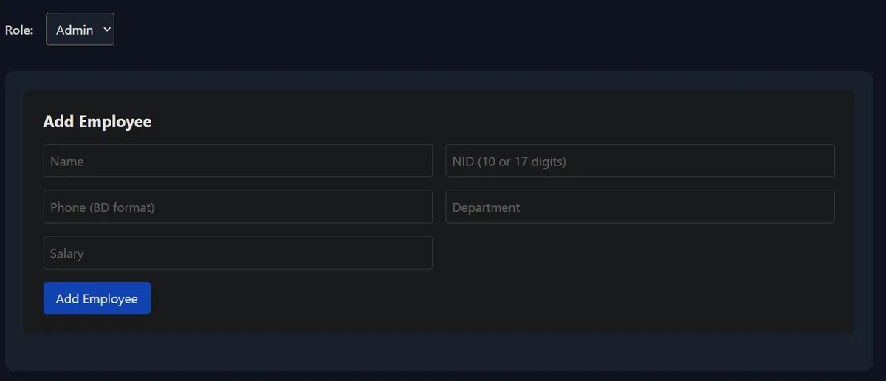
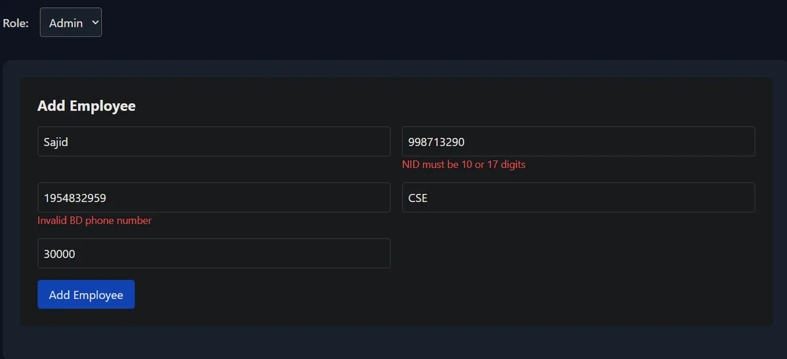
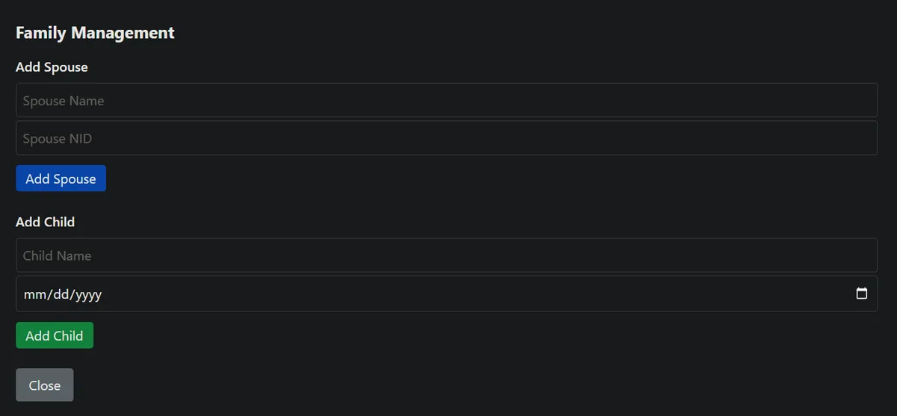
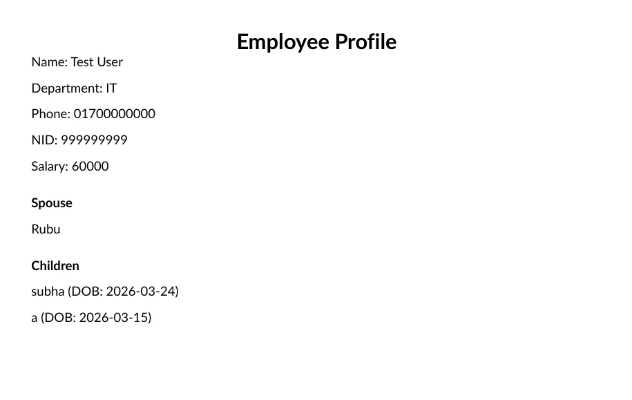
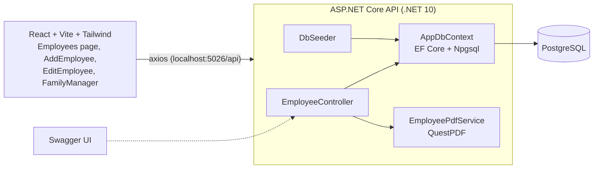
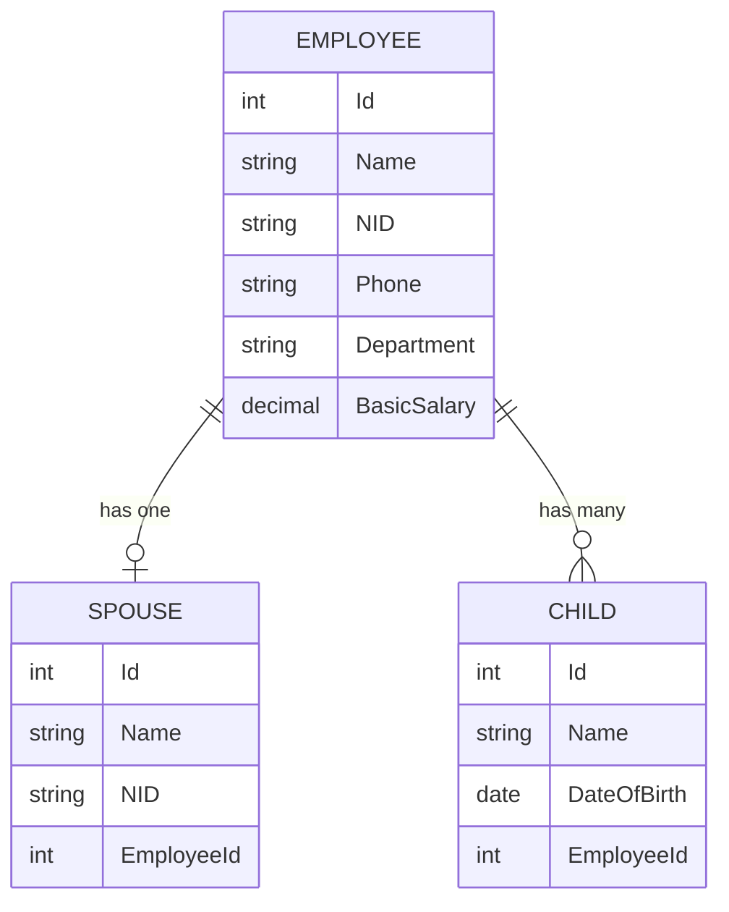

<div align="center">



<p><code>Employee registry with spouse and children records, search and PDF exports: ASP.NET Core, PostgreSQL and React</code></p>

<p>
<a href="https://github.com/Saji-d/employee-family-registry"></a>

<a href="SRS_Document.pdf"></a>
</p>

<p>


</p>

> Built as a technical assessment. Independent implementation, not affiliated with or endorsed by any company.

<p>
<a href="#-overview">Overview</a> · <a href="#-highlights">Highlights</a> · <a href="#-preview">Preview</a> · <a href="#-architecture">Architecture</a> · <a href="#-tech-stack">Tech Stack</a> · <a href="#-getting-started">Getting Started</a> · <a href="#-project-structure">Structure</a> · <a href="#-author">Author</a>
</p>

</div>


## ◈ Overview

A full-stack employee management app. Staff records carry a spouse and any number of children; the registry can be searched and exported to PDF. It also validates Bangladeshi identifiers: National ID numbers (10 or 17 digits) and phone numbers.

It is a technical assessment project, built from a Software Requirements Specification: the repository includes [`SRS_Document.pdf`](SRS_Document.pdf) with the requirements, ERD, architecture, assumptions and edge cases.

> **Honest scope.** The Admin and Viewer switch is a UI-level toggle only. The API has no authentication or authorization, so treat it as a demo of the role-based interface and not as access control. CORS allows only `http://localhost:5173`.


## ◈ Highlights

<table width="100%">
<tr>
<td width="33%" valign="top">

**Employee CRUD**<br/>
Create, read, update and delete employees with name, NID, phone, department and basic salary.

</td>
<td width="33%" valign="top">

**Family records**<br/>
One spouse per employee and any number of children with date of birth, with the rules enforced by the API.

</td>
<td width="33%" valign="top">

**Global search**<br/>
Case-insensitive search by name, NID or department with debounced requests from the UI.

</td>
</tr>
<tr>
<td width="33%" valign="top">

**PDF reports**<br/>
Export the filtered registry list or a single employee profile, generated server-side with QuestPDF.

</td>
<td width="33%" valign="top">

**Local validation rules**<br/>
Unique NID, 10 or 17 digit NID format, Bangladesh phone format and a unique spouse NID.

</td>
<td width="33%" valign="top">

**Seeded demo data**<br/>
Ten sample employees are inserted on first run, so the app is explorable straight away.

</td>
</tr>
</table>


## ◈ Preview

<div align="center">

</div>

<br/>

<table width="100%">
<tr>
<td width="50%" align="center"><br/><sub>Registry dashboard</sub></td>
<td width="50%" align="center"><br/><sub>Global search</sub></td>
</tr>
<tr>
<td width="50%" align="center"><br/><sub>Add employee</sub></td>
<td width="50%" align="center"><br/><sub>NID, phone and salary validation</sub></td>
</tr>
<tr>
<td width="50%" align="center"><br/><sub>Spouse and children</sub></td>
<td width="50%" align="center"><br/><sub>Employee profile PDF</sub></td>
</tr>
</table>


## ◈ Architecture

The React UI talks to a single REST controller. EF Core maps three entities to PostgreSQL. A QuestPDF service renders the reports.





<details>
<summary><strong>REST API overview</strong></summary>

| Method | Endpoint | Purpose |
|---|---|---|
| GET | `/api/Employee` | List employees with spouse and children |
| GET | `/api/Employee/{id}` | Get one employee |
| GET | `/api/Employee/search?query=` | Search by name, NID or department |
| POST | `/api/Employee` | Create an employee (NID must be unique) |
| PUT | `/api/Employee/{id}` | Update an employee |
| DELETE | `/api/Employee/{id}` | Delete an employee |
| POST | `/api/Employee/{id}/spouse` | Add a spouse (one per employee, unique NID) |
| POST | `/api/Employee/{id}/children` | Add a child |
| GET | `/api/Employee/export/pdf?query=` | PDF of the (optionally filtered) registry |
| GET | `/api/Employee/{id}/export/cv` | PDF profile of one employee |

</details>


## ◈ Tech Stack

| Layer | Technologies | Purpose |
|---|---|---|
| API | ASP.NET Core on .NET 10, Swashbuckle (Swagger) | REST endpoints and interactive docs |
| Data | Entity Framework Core, Npgsql, PostgreSQL | ORM, migrations and storage |
| Validation | DataAnnotations on the entities plus controller checks | NID, phone and family rules |
| Reports | QuestPDF (Community licence) | Registry and profile PDFs |
| Frontend | React 19, Vite, Tailwind CSS 3, Axios | Registry UI |


## ◈ Getting Started

**Prerequisites:** .NET 10 SDK, Node.js 18 or newer, PostgreSQL and the `dotnet-ef` tool (`dotnet tool install --global dotnet-ef`).

**1. Database.** Create an empty PostgreSQL database such as `employee_registry`, then set `ConnectionStrings:DefaultConnection` in `backend/EmployeeRegistry.Api/appsettings.json` (or in your user secrets) to point at it.

**2. Backend.** The seeder runs on startup, so apply the migration first.

```bash
cd backend/EmployeeRegistry.Api
dotnet ef database update
dotnet run          # http://localhost:5026, Swagger at /swagger
```

**3. Frontend.** The API base URL is set to `http://localhost:5026/api` in `src/services/api.js`.

```bash
cd frontend/employee-registry-ui
npm install
npm run dev         # http://localhost:5173
```


## ◈ Project Structure

The `backend/` folder holds the ASP.NET Core API and the `frontend/` folder holds the React UI. `docs/` has the README images and `SRS_Document.pdf` is the specification.

<details>
<summary>Open the folder map</summary>

```text
.
├── backend/EmployeeRegistry.Api/
│   ├── Controllers/       # EmployeeController
│   ├── Data/              # AppDbContext, DbSeeder
│   ├── Entities/          # Employee, Spouse, Child
│   ├── Services/          # EmployeePdfService (QuestPDF)
│   ├── Migrations/        # EF Core migration
│   └── Program.cs
├── frontend/employee-registry-ui/
│   └── src/
│       ├── components/    # AddEmployee, EditEmployee, FamilyManager
│       ├── pages/         # Employees
│       └── services/      # api.js (Axios client)
├── docs/                  # preview and screenshots
├── screenshots/           # original captures
└── SRS_Document.pdf
```

</details>


## ◈ Author

**Sajidur Rahman Sajid**: Full-Stack Developer and AI engineer from Dhaka.<br>
BSc in CSE at American International University-Bangladesh (AIUB).

<p>
  <a href="https://www.sajidur.me"></a>
  <a href="https://www.linkedin.com/in/sajidur-rahman-sajid/"></a>
  <a href="https://github.com/Saji-d"></a>
  <a href="mailto:sajidsajidurrahman99@gmail.com"></a>
</p>

<sub>Built as a full-stack technical assessment project.</sub>
